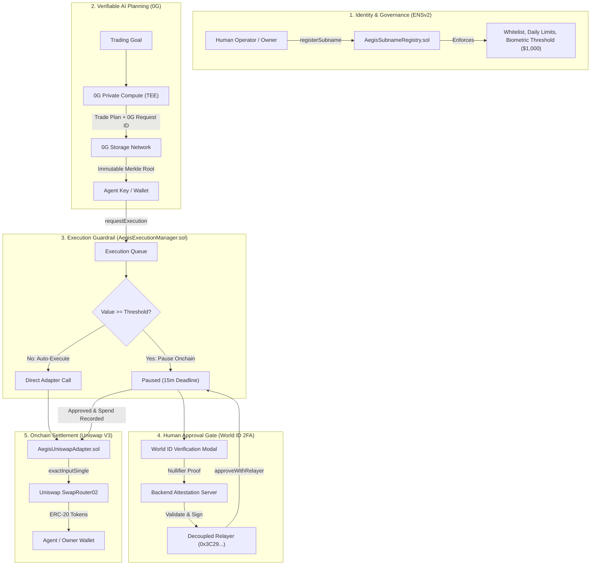
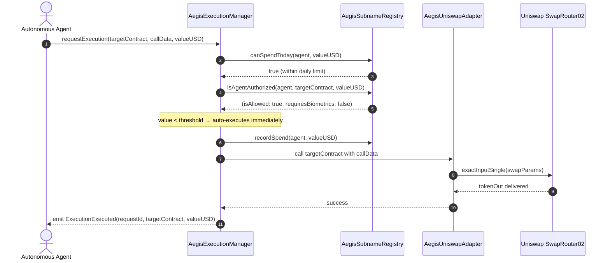
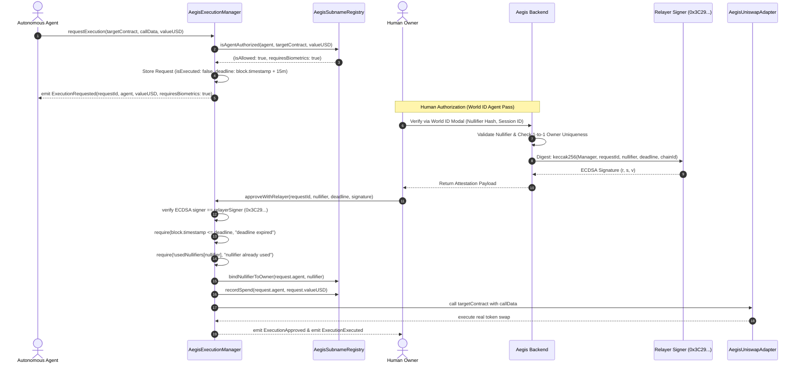
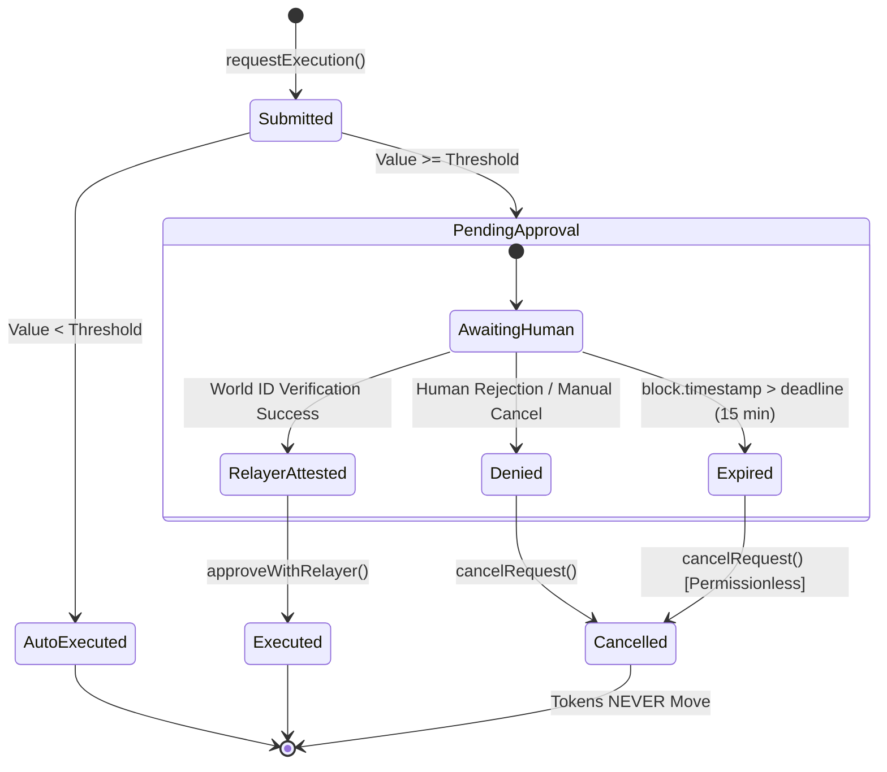

# AegisNet Smart Contracts Architecture & Workflow

AegisNet is a guardrailed execution infrastructure for autonomous AI trading agents on Ethereum. It decouples agent identity, risk bounds, human authorization, and DeFi execution into modular, verifiable smart contracts deployed on Ethereum Sepolia.

---

## 📜 Deployed Contracts (Sepolia)

All contracts are deployed, active, and verifiable on Ethereum Sepolia (Chain ID `11155111`):

| Contract | Address | Source File | Role |
| :--- | :--- | :--- | :--- |
| **AegisSubnameRegistry** | [`0x6Dbd89B71e8AB7BF93a9200C6fB81951699549FE`](https://sepolia.etherscan.io/address/0x6Dbd89B71e8AB7BF93a9200C6fB81951699549FE#code) | [`AegisSubnameRegistry.sol`](contracts/contracts/AegisSubnameRegistry.sol) | Agent identity (ENS subnames), owner permissions, contract whitelisting, daily spend tracking, and human nullifier bindings. |
| **AegisExecutionManager** | [`0x13d7b8Add8265AB1Cfdc3a6E8E60D1b3bcD56fa8`](https://sepolia.etherscan.io/address/0x13d7b8Add8265AB1Cfdc3a6E8E60D1b3bcD56fa8#code) | [`AegisExecutionManager.sol`](contracts/contracts/AegisExecutionManager.sol) | Central queue, threshold gating, Human Approval Gate (World ID 2FA relayer attestations), 15-minute deadlines, and atomic execution. |
| **AegisUniswapAdapter** | [`0x6383A973B4d65a48E489f22F9eD298CA7230C185`](https://sepolia.etherscan.io/address/0x6383A973B4d65a48E489f22F9eD298CA7230C185#code) | [`AegisUniswapAdapter.sol`](contracts/contracts/AegisUniswapAdapter.sol) | Execution adapter for real Uniswap V3 swaps via official `SwapRouter02` with ERC-20 approvals and slippage verification. |
| **AegisSwapVMAdapter** | [`0xb81b7Ec40eF275AA805Cb82D729498C47Ab64c60`](https://sepolia.etherscan.io/address/0xb81b7Ec40eF275AA805Cb82D729498C47Ab64c60#code) | [`AegisSwapVMAdapter.sol`](contracts/contracts/AegisSwapVMAdapter.sol) | 1inch SwapVM custom opcode router supporting standard swaps and Aqua liquidity positions (manager-only). |

### Protocol Accounts & Key Separation

AegisNet enforces strict separation of privilege across on-chain entities:

| Role | Address | Description |
| :--- | :--- | :--- |
| **Deployer & Protocol Owner** | [`0xB6Ba1Be32B7cA2729551882B71E8F469D06510e6`](https://sepolia.etherscan.io/address/0xB6Ba1Be32B7cA2729551882B71E8F469D06510e6) | Deploys contracts, sets the Execution Manager in Registry, and manages emergency controls. |
| **Relayer Signer (Approval Attestor)** | [`0x3C29CC205E4fb3e1cA6C89DECDFE5A5d4e46E799`](https://sepolia.etherscan.io/address/0x3C29CC205E4fb3e1cA6C89DECDFE5A5d4e46E799) | Holds **no ETH** and performs **no transactions**. Exclusively signs off-chain attestations validating World ID human proof-of-humanity verification. Verified on-chain via `AegisExecutionManager.relayerSigner`. |
| **Sample Agent (`agent1.aegisnet.eth`)** | [`0xB6Ba1Be32B7cA2729551882B71E8F469D06510e6`](https://sepolia.etherscan.io/address/0xB6Ba1Be32B7cA2729551882B71E8F469D06510e6) | Registered ENS agent subname configured with a $1,000 threshold and $10,000 daily spend limit. |

### External Ecosystem Contracts (Sepolia & 0G)

| Protocol | Contract | Address |
| :--- | :--- | :--- |
| **Uniswap** | SwapRouter02 | [`0x3bFA4769FB09eefC5a80d6E87c3B9C650f7Ae48E`](https://sepolia.etherscan.io/address/0x3bFA4769FB09eefC5a80d6E87c3B9C650f7Ae48E) |
| **Uniswap** | Universal Router | `0x3A9D48AB9751398BbFa63ad67599Bb04e4BdF98b` |
| **Uniswap** | Permit2 | `0x000000000022D473030F116dDEE9F6B43aC78BA3` |
| **Uniswap** | WETH/USDC 0.3% Pool | [`0x6Ce0896eAE6D4BD668fDe41BB784548fb8F59b50`](https://sepolia.etherscan.io/address/0x6Ce0896eAE6D4BD668fDe41BB784548fb8F59b50) |
| **Canonical Tokens** | Wrapped Ether (WETH9) | [`0xfFf9976782d46CC05630D1f6eBAb18b2324d6B14`](https://sepolia.etherscan.io/address/0xfFf9976782d46CC05630D1f6eBAb18b2324d6B14) |
| **Canonical Tokens** | Circle USD (USDC) | [`0x1c7D4B196Cb0C7B01d743Fbc6116a902379C7238`](https://sepolia.etherscan.io/address/0x1c7D4B196Cb0C7B01d743Fbc6116a902379C7238) |
| **0G Galileo** | Storage Flow Contract | `0x22e03a6a89b950f1c82ec5e74f8eca321a105296` (Chain ID `16602`) |

---

## 🔄 End-to-End Execution Workflow

### 1. High-Level Protocol Architecture



---

### 2. Low-Value Flow (Atomic Auto-Execution)

When a trade is below the agent's configured approval threshold (e.g., $0.30 USD < $1,000.00):



**Sepolia Proof:** [`0x79640a20abab184f469218c0774b4c809e1944f3fe6bcab771f21f42ffccb0dd`](https://sepolia.etherscan.io/tx/0x79640a20abab184f469218c0774b4c809e1944f3fe6bcab771f21f42ffccb0dd)

---

### 3. High-Value Flow (Human Approval Gate & Relayer Attestation)

When an agent proposes a trade at or above the threshold (e.g., $3.00 USD $\ge$ $1.00 threshold or $2,500 USD $\ge$ $1,000 threshold):



**Sepolia Proof:**
* Request Paused Onchain: [`0xd530468647deee80ddb3a3a4836894aa1b08b4d28159eb313dfcc47ebda32f42`](https://sepolia.etherscan.io/tx/0xd530468647deee80ddb3a3a4836894aa1b08b4d28159eb313dfcc47ebda32f42)
* Clearance & Immediate Execution: [`0x6d7a5084f3b842d5bf0280b9b38928429d4c9853966a3fb8fa722cf4679ca596`](https://sepolia.etherscan.io/tx/0x6d7a5084f3b842d5bf0280b9b38928429d4c9853966a3fb8fa722cf4679ca596)

---

### 4. Denied & Expired Guardrail Paths

AegisNet guarantees funds remain strictly safe if human approval is withheld or delayed:



1. **Explicit Denial (Human Cancel):** The owner rejects the biometric prompt. The request is permanently marked canceled via `cancelRequest` onchain, emitting `ExecutionCancelled`. Tokens remain safe.
   * **Sepolia Proof:** [`0xaea034effa80f025a480c9e0754704c32558ae1291111075717acf07a9a835a2`](https://sepolia.etherscan.io/tx/0xaea034effa80f025a480c9e0754704c32558ae1291111075717acf07a9a835a2)
2. **Expired Deadline (15-Minute Expiry):** If approval is not provided within 15 minutes, `approveWithRelayer` strictly reverts with `AegisManager: deadline expired`. Any public user can call `cancelRequest` to prune expired state.
   * **Sepolia Proof:** Revert confirmed on Request `0x428e6feccb66c567acffb0909bcea55e85e1e93865c448ce67fd79e8491a1209`.

---

## 🔬 Core Smart Contract Specifications

### 1. `AegisSubnameRegistry.sol`
* **Source:** [`contracts/contracts/AegisSubnameRegistry.sol`](contracts/contracts/AegisSubnameRegistry.sol)
* **Key Functions:**
  * `registerSubname(bytes32 parentNode, string label, address agent, address targetContract, uint256 thresholdUSD, uint256 dailyLimitUSD)`: Registers an ENS subname and sets operational limits.
  * `isAgentAuthorized(address agent, address target, uint256 amountUSD)`: View helper verifying whitelist, daily limit, and whether threshold is exceeded.
  * `recordSpend(address agent, uint256 amountUSD)`: Protected by `onlyManager` modifier; records spend and handles daily reset (`block.timestamp / 1 days`).
  * `bindNullifierToOwner(address owner, uint256 nullifierHash)`: Enforces 1-to-1 binding between human nullifier and owner address; rejects nullifier reuse across accounts.
  * `setExecutionManager(address _manager)`: Owner-only one-time setup linking the registry to the Execution Manager.

### 2. `AegisExecutionManager.sol`
* **Source:** [`contracts/contracts/AegisExecutionManager.sol`](contracts/contracts/AegisExecutionManager.sol)
* **Key Functions:**
  * `requestExecution(address targetContract, bytes calldata data, uint256 valueUSD)`: Entrypoint for agents; auto-executes low-value trades and holds high-value trades with a 15-minute deadline.
  * `approveWithRelayer(bytes32 requestId, uint256 nullifierHash, uint256 deadline, bytes calldata relayerSignature)`: Cryptographically verifies the relayer attestation, checks expiry, marks nullifier used, records spend, and executes target atomically.
  * `cancelRequest(bytes32 requestId)`: Allows the request owner to cancel, or anyone if past deadline.
  * `setRelayerSigner(address newSigner)`: Protocol owner setter to rotate the relayer key without redeploying.

### 3. `AegisUniswapAdapter.sol`
* **Source:** [`contracts/contracts/AegisUniswapAdapter.sol`](contracts/contracts/AegisUniswapAdapter.sol)
* **Key Functions:**
  * `executeExactInputSingle(bytes calldata callData)`: Restricts swap execution strictly to `AegisExecutionManager`.
  * `_performUniswapSwap(...)`: Transfers `tokenIn` via `IERC20.transferFrom`, sets ERC-20 approval for `SwapRouter02`, calls `ISwapRouter02.exactInputSingle`, and validates minimum `tokenOut` output.

---

## 🧪 Testing and Verification

Run the full contract test suite:
```bash
cd contracts && npm test
```

Expected result:
```text
  AegisNet Matrix Core Protocol Tests
    Phase I: Identity & Delegation (ENSv2 EAC)
      √ Should register agent subname and set EAC target whitelists
      √ Should flag high-value actions for World ID biometric interception
      √ Should set and resolve ENSIP-26 Agent Text Records
      √ Should allow owner to set executionManager once and prevent resetting
      √ Should restrict recordSpend to only executionManager and revert on outside caller
    Phase II & III: Strategy Execution & Human Approval Interception
      √ Should auto-execute transactions below $1,000 threshold
      √ Should intercept transaction above $1,000 and enforce human approval via relayer
      √ Should verify approval via backward-compatible alias and block nullifier replay
      √ Should accurately track request lifecycle via view helpers
      √ Should reject approveWithRelayer with invalid or forged signature
      √ Should enforce daily spend limit on requestExecution (under-limit, over-limit, and next-day reset)
      √ Should verify approval signatures against distinct relayer and allow owner to rotate relayer
      √ Should expire pending high-value executions after 15 minutes and allow anyone to cancel them
      √ Should bind each owner to one verified human nullifier and reject reuse across owners
      √ Should verify and immediately execute trade with World ID Agent Pass approveWithRelayer
      √ Should prevent execution and leave trade unexecuted on human denial (denied path)
      √ Should reject approveWithRelayer and leave trade unexecuted on expired deadline (expired path)
      √ Should reject approveWithRelayer and leave trade unexecuted on cancelled request (cancelled path)
    Phase IV: 1inch Aqua Protocol & SwapVM Custom Opcode Positions
      √ Should construct and execute custom 1inch Aqua position deposit (0x05) via SwapVM
      √ Should execute 1inch Aqua position rebalancing & harvest yield (0x06)
    Phase V: Real Uniswap V3 Token Swaps via AegisUniswapAdapter & SwapRouter02
      √ Should execute a real Uniswap V3 swap with real ERC-20 transferFrom and delivery
      √ Should pause high-value Uniswap trade, require World ID Agent Pass approval, and execute real swap
      √ Should strictly revert and leave tokens untouched if slippage threshold is breached
      √ Should support direct executeSwap helper method

  Uniswap V3 Official Sepolia Deployment Verification
    √ Should confirm official Uniswap Sepolia contract addresses match canonical deployments
    √ Should properly initialize AegisUniswapAdapter with official SwapRouter02 address
    √ Should encode exactInputSingle call data matching ISwapRouter02 specification

  27 passing (4s)
```
